# OCTOPUS

### Development

By *Marin Jeunot*(marin.jeunot@epitech.eu) & *Sacha Lemée*(sacha.lemee@epitech.eu).

## Objective

- "*You are going to work again with the poll application you worked with during the Popeye project. [...]. This time, you are going to deploy the application onto 5 different machines, without using containers, by using Ansible.*"
[OCTOPUS EPITECH Subject](doc/G-DOP-400_octopus.pdf)

## License

This project is licensed under the **MIT License**.

